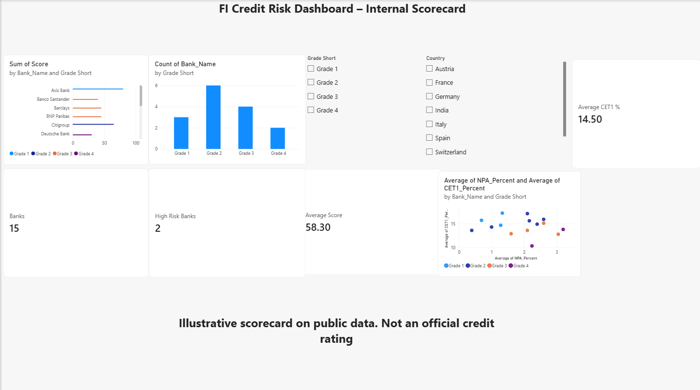
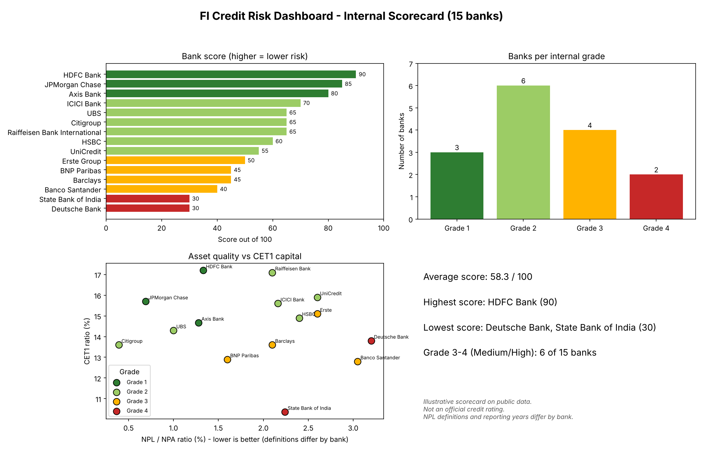

# FI Credit Risk Dashboard

An interactive dashboard that visualises an internal credit-risk scorecard of 15 large banks (India, Europe, UK, US). It is built in two versions: **Power BI** and **Python (matplotlib)**.

> **Illustrative learning project. Grades are an internal, relative scorecard, not official credit ratings.**

## Power BI version


- File: `powerbi/fi_credit_risk_dashboard.pbix` (open with Power BI Desktop, which is free)
- Cards: number of banks, average score, average CET1 ratio, number of high-risk banks
- Charts: bank score by grade (bar), banks per grade (column), NPL ratio vs CET1 ratio (scatter)
- Slicers: filter everything by country or by internal grade
- DAX measures and calculated columns are listed in `powerbi/dax_measures.md`; step-by-step build notes are in `powerbi/BUILD_GUIDE.md`

## Python version


`dashboard.py` draws the same views with pandas and matplotlib from `data/scored_banks.csv`.

## What the dashboard shows
1. **Bank score:** every bank's score out of 100, coloured by internal grade.
2. **Banks per grade:** how many banks fall in Grade 1 (very low risk) to Grade 4 (high risk).
3. **Asset quality vs CET1 capital:** NPL ratio against CET1 ratio, one dot per bank.
4. **Headline numbers:** average score, average CET1 ratio, number of banks and high-risk banks.

## Where the data comes from
`data/scored_banks.csv` is produced by the companion project **fi-counterparty-credit-rating-model**, which holds the raw data (company annual results with source links), the scoring method and the Excel report. Please read its README for the method and limitations.

## Run the Python version
```
pip install -r requirements.txt
python dashboard.py
```

## Limitations
- Small sample of 15 banks; grades are relative to this sample only.
- NPL definitions differ by bank (Gross NPA, NPL, NPE, Stage 3, non-accrual), so the NPL axis is not perfectly comparable.
- HDFC and Axis are FY2025; the other banks are FY2024. Currency amounts are converted approximately.
- Simple three-factor scorecard with judgement-based thresholds; not validated or back-tested.

## Skills demonstrated
Power BI (DAX measures, calculated columns, slicers, interactive visuals); Python (pandas, matplotlib); data visualisation and communication of bank credit-risk results.
